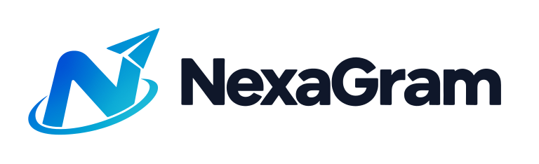

  

# NexaGram

NexaGram is an unofficial Telegram desktop client built on [Telegram Desktop](https://github.com/telegramdesktop/tdesktop) and [64Gram](https://github.com/TDesktop-x64/tdesktop). It adds resumable downloads, download management, chat filters, and more control over message selection and forwarding.

[Download NexaGram](https://github.com/rumalg123/NexaGram/releases) · [View all features](features.md) · [Report an issue](https://github.com/rumalg123/NexaGram/issues)

[Telegram group](https://t.me/nexagram_chat) · [Telegram channel](https://t.me/nexagram_channel)

## First launch

The first public Windows x64 release is planned as **NexaGram 1.0.0 beta**. Install it in a separate directory or extract the portable ZIP to a new folder, then sign in. NexaGram uses its own profile and signed update feed. Existing Telegram Desktop and 64Gram installations keep their own profiles.

Open **Settings → Advanced → Resumable Downloads** to enable [resumable downloads](docs/resumable-downloads.md), then restart NexaGram. The option to resume interrupted downloads on startup is separate and defaults to Off. **Install beta versions** in Advanced controls eligibility for future beta updates on installations configured for signed updates.

**About** shows the NexaGram version followed by the Telegram Desktop upstream version and the original 64Gram base version.

## Build from source

- [Windows](docs/building-win.md)
- [macOS](docs/building-mac.md)
- [Linux using Docker](docs/building-linux.md)
- [Update packaging and signed feeds](Telegram/build/updates.md)

The English strings for inherited 64Gram enhancements are in [en.json](Telegram/Resources/langs/localization/en.json). NexaGram UI strings live in [lang.strings](Telegram/Resources/langs/lang.strings).

## License and credits

NexaGram is distributed under the [GNU GPL v3 with the OpenSSL exception](LICENSE). It builds on Telegram Desktop, 64Gram and contributions from [Kotatogram](https://github.com/kotatogram/kotatogram-desktop). The Telegram Widget engine uses [Nova](https://github.com/trynova/nova), which is published under the [Mozilla Public License 2.0](https://github.com/trynova/nova/blob/main/LICENSE.md).
